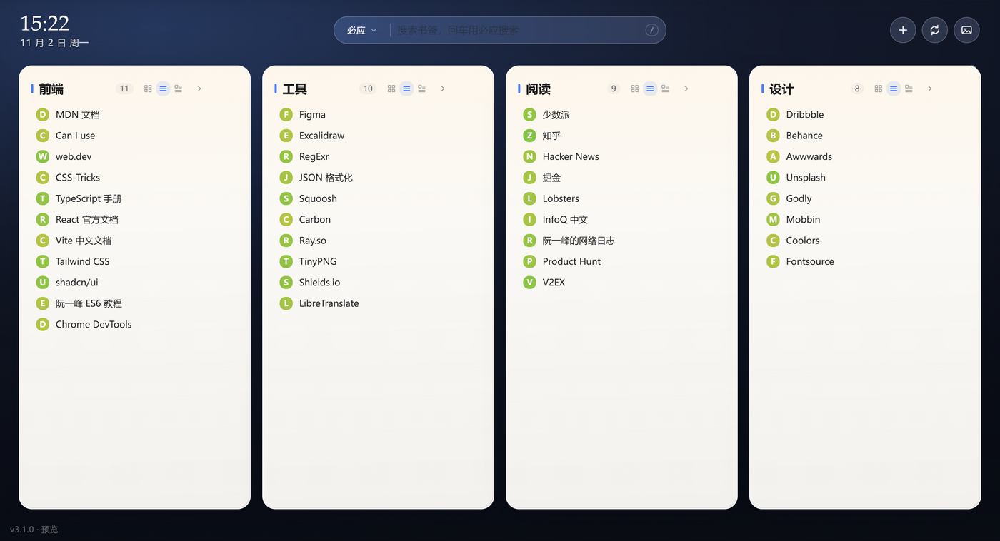
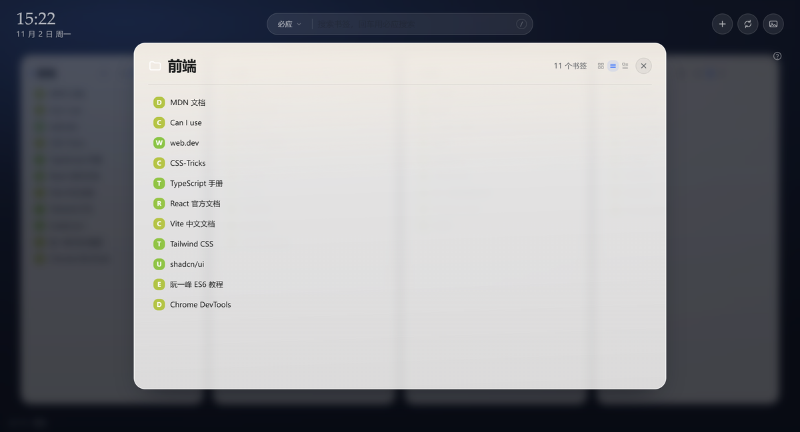

# 书签桌面 · Bookmark Desktop

把浏览器书签栏变成一张「便签纸桌面」：书签栏里的**每个文件夹 = 一张横向铺开的纸卡**，点标题就平滑放大、逐级进入子文件夹；书签和文件夹都能直接拖进别的文件夹整理；常去的站点可以置顶成一排 App 图标；背景跟着必应每日壁纸走，纸卡会从背景里借一点颜色。



`Chrome MV3` · `React 19 + TypeScript` · `Vite` · `数据只留在本机，不登录、不上报`

---

## 目录

- [它长什么样](#它长什么样)
- [功能](#功能)
- [安装](#安装)
- [不装扩展也能看（预览模式）](#不装扩展也能看预览模式)
- [开发](#开发)
- [项目结构](#项目结构)
- [实现要点](#实现要点)
- [数据与隐私](#数据与隐私)
- [兼容性](#兼容性)

## 它长什么样

上面那张就是桌面：书签栏里的四个文件夹各占一张纸卡，卡片里直接列着书签。点开其中一张，放大层长这样：



放大层是固定尺寸的，翻文件夹时不会忽大忽小；子文件夹在里面排成网格，可以继续往下进。

## 功能

**桌面**

- 书签栏里的每个文件夹渲染成一张卡片，按文件夹顺序横向铺开；卡片直接显示里面的书签和子文件夹，不用一层层点进去。
- 书签栏里散落的书签自动合成一张「未分组」卡片，不会丢东西。
- 顶部有时钟、日期和多引擎搜索框；右上角三个按钮：新建分组、布局同步、更换壁纸。
- 常去的站点可以「置顶」到时钟下方，变成一排 App 图标，顺序可拖。

**放大层**

- 点卡片标题 → 平滑放大成固定尺寸的放大层，内容再多也在卡片里滚动，翻文件夹时不会忽大忽小。
- 子文件夹在放大层里排成网格，可以继续往下进；`Esc` 或 `Backspace` 返回上一层，右上角有常驻关闭按钮。

**整理（全部靠拖）**

- 书签、子文件夹可以直接拖到**别的卡片**里，不用先进去再拖。
- 一级卡片之间可以拖动调整先后顺序。
- 置顶图标可以拖到任意位置排序（插到指定位置，不是两两互换）。
- 拖到列表上下边缘时出现插入线，拖到卡片中间才是「放进这个文件夹」。

**显示方式**

- 每张卡片能选 **图标 / 列表 / 混搭**，单条书签也能单独选 图标 / 列表，两者互不覆盖；没设过的书签跟随最近的祖先文件夹。
- 「混搭」= 这一卡里每条书签照它自己记着的样式来（没设过的按列表），所以同一张卡片里图标和列表可以混排。

**右键**

- 右键书签：打开 / 在新标签页打开 / 复制地址 / 添加到别的文件夹 / 以图标或列表显示 / 重命名 / 删除。
- 右键卡片：新建书签、新建子文件夹、切换显示方式、按名称排序、重命名、删除。
- 右键书签栏空白处：新建书签 / 新建分组 / 按名称排序 / 更换壁纸。

**壁纸**

- 8 套渐变预设（5 深 3 浅），不联网、不加载图片。
- 必应每日壁纸：面板里是**最近 9 天的九宫格**，点哪天用哪天；可选 4 档高斯模糊，让照片只当氛围。
- 纸卡会从当前壁纸里取一点色相和明度，换壁纸时整页基调跟着变；浅色壁纸下界面自动切成浅色纸。

**搜索**

- 支持必应 / 百度 / Google 三家，回车直接搜；输入的内容像网址时回车直接打开该站点。

**布局同步：一段 JSON 文本**

- 布局（置顶顺序、显示方式、壁纸、搜索引擎、模糊档位）能导出成一段缩进好的 JSON；复制走，在另一台设备的同一个面板里粘进去，点「检查并导入」。
- 全程只有文本：不落文件、不压缩、不走链接 —— 聊天框、备忘录、邮件，能打字的地方都能传。
- 跨设备靠「规范化 URL + 文件夹标题路径」对齐，不依赖本机书签 id（每台设备分配的 id 完全不同）；对不上的条目会先报数字再跳过，不硬塞。
- 导入是整体覆盖，但分两步：先给一份预览（要改哪些、几项对不上），点「确认覆盖」才真的写存储。书签本身一根指头都不碰。

**键盘**

| 按键 | 作用 |
| --- | --- |
| `/` | 聚焦搜索框 |
| `?` | 打开快捷键速查 |
| `Esc` | 关弹层 / 清空搜索 |
| `Backspace` | 放大层里返回上一层 |
| `↑ ↓ ← →` | 在卡片、书签之间移动焦点 |
| `Shift + F10` | 对当前焦点项打开右键菜单 |
| `Tab` | 键盘模式（只有键盘操作才画焦点环） |

## 安装

扩展加载的是**构建产物 `dist/`**，不是仓库根目录。

```bash
pnpm install
pnpm build          # 产物直接生成到 dist/
```

然后：

1. Chrome 打开 `chrome://extensions`（Edge 是 `edge://extensions`）
2. 右上角打开「开发者模式」
3. 点「加载已解压的扩展程序」，选中本仓库的 **`dist/` 目录**
4. 新开一个标签页即可

> `dist/` 已加入 `.gitignore`，克隆仓库后先 `pnpm build` 再加载。
> 改了代码：重新 `pnpm build`，回扩展页点一下「刷新」，再重开新标签页。

## 不装扩展也能看（预览模式）

直接双击 `dist/newtab.html` 用浏览器打开，就是完整的界面预览 —— 没有 `chrome.bookmarks` 时铺一套示例书签，放大层、拖拽、切换显示方式、换壁纸都能走一遍。

也可以 `pnpm dev` 起开发服务器，打开 **<http://localhost:5173/newtab.html>**（注意 `http://localhost:5173/` 是 404，入口在 `newtab.html`）。

## 开发

```bash
pnpm install
pnpm dev            # 开发服务器 http://localhost:5173/newtab.html
pnpm build          # tsc -b && vite build → dist/
pnpm watch          # 边改边出包
```

技术栈：React 19 + TypeScript + Vite + Tailwind CSS（关掉 `preflight`，只用来写新样式）。没有后端、没有账号体系，改完一处样式重构建一次就能看到。

## 项目结构

```
.
├── app/                      # 源码（Vite 的 root）
│   ├── newtab.html           # 入口页
│   ├── public/               # 原样拷贝到 dist/：manifest.json、icons/
│   └── src/
│       ├── main.tsx          # 挂载点
│       ├── App.tsx           # 页面骨架
│       ├── components/       # topbar / board / panels / shell / icons
│       ├── lib/              # store、tree、drag、keys、menus、sync、bing、wallpaper…
│       └── styles/legacy.css # 全部视觉：纸卡、顶栏、弹层
├── dist/                     # 构建产物（扩展加载这里）
├── docs/screenshots/         # README 配图
├── vite.config.ts
└── tailwind.config.ts
```

## 实现要点

- **状态**：一个可变的 `state` 对象 + `bump()` 触发重渲染，组件用 `useSyncExternalStore` 订阅；改完数据调一次 `bump()` 就行，没有 reducer、没有不可变数据层。
- **样式**：视觉集中在 `app/src/styles/legacy.css`（从老版 `newtab.css` 逐字搬来，像素由它负责）；Tailwind 关掉 `preflight`，只用来写新加的布局类，免得把既有排版洗一遍。
- **产物形态**：打成 **iife 单文件 + `<script defer>`**。扩展页本来能吃 ES module，但 `file://` 下的 module 会被 CORS 拦死 —— 而「双击 `newtab.html` 直接预览」是要保留的能力，所以走传统脚本。
- **书签树**：`chrome.bookmarks` 给的是扁平节点，进内存后建 `byId` / `parentId` 索引再渲染；拖动、重命名、删除都是先调 `chrome.bookmarks.*`，成功后重新拉树。

## 数据与隐私

- 只申请 `bookmarks` / `favicon` / `storage` 三个权限，唯一的外部域名是 `https://www.bing.com/*`（取每日壁纸）。
- 偏好（壁纸、显示方式、置顶顺序、搜索引擎）存在 `chrome.storage.local`；预览模式退到 `localStorage`，键加 `bd:` 前缀免得和别的本地页面打架。卸载扩展即清空。
- 没有账号、没有后端、没有埋点；同步布局用的那段 JSON 是本地生成的文本，发给谁、给不给，全由你决定。

## 兼容性

Chrome / Edge 110+（构建目标 `chrome110`）。Firefox 未适配。

---

历史版本的改动记录、当时的取舍和踩过的坑，都整理在 [CHANGELOG.md](CHANGELOG.md)。
